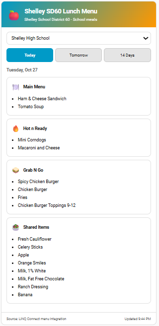

# Shelley SD60 Lunch Card

<p align="center">
  
</p>

A collection of visual Lovelace cards for the Shelley SD60 school lunch menus, designed for Home Assistant and the `shelley-sd60-school-lunches` integration.



## Cards included

### Shelley SD60 Lunch Card

The full interactive lunch card with school selection and Today, Tomorrow, and 14 Days views.

```yaml
type: custom:shelley-sd60-lunch-card
title: Shelley SD60 Lunch Menu
default_school: hobbs_middle
```

### Shelley SD60 Tomorrow Card

A compact card focused only on tomorrow's lunch menu. It can be useful when you want a simple dashboard card without the school/date controls of the full card.

```yaml
type: custom:shelley-sd60-tomorrow-card
entity: sensor.shelley_high_school_lunch_tomorrow
title: Tomorrow's Lunch
school: Shelley High School
```

The Tomorrow Card automatically recognizes elementary, middle-school, and high-school menu sections from the entity attributes. The `school` field is optional and is only used to customize the displayed school name.

## Features

- Select any of the six Shelley SD60 schools with the full Lunch Card.
- Switch between Today, Tomorrow, and 14 Days with the full Lunch Card.
- Dedicated Tomorrow Card for a compact tomorrow-only dashboard view.
- Shows live menu items from Home Assistant sensor attributes.
- Separate meal-group sections for Hobbs Middle School and Shelley High School.
- Theme-aware styling; no external JavaScript dependencies.
- Both cards are delivered by the same HACS-installed JavaScript resource.

## Install through HACS

1. Add this repository in HACS under **Custom repositories** with category **Dashboard**.
2. Install **Shelley SD60 Lunch Card**.
3. Add either card to a dashboard using a Manual card.

HACS installs the single JavaScript resource `shelley-sd60-lunch-card.js`, which registers both custom card types.

## Entity configuration

The full Lunch Card uses the standard entity IDs generated by the Shelley SD60 School Lunches integration. Home Assistant can preserve previously assigned entity IDs; if yours differ, override them in card YAML:

```yaml
type: custom:shelley-sd60-lunch-card
entities:
  hobbs_middle:
    today: sensor.hobbs_middle_school_lunch_today
    tomorrow: sensor.hobbs_middle_school_lunch_tomorrow
    14days: sensor.hobbs_middle_school_lunch_14_day_menu
    groups:
      Second Line: sensor.hobbs_middle_school_lunch_second_line
```

For the Tomorrow Card, specify the tomorrow sensor directly:

```yaml
type: custom:shelley-sd60-tomorrow-card
entity: sensor.hobbs_middle_school_lunch_tomorrow
```

## Integration dependency

Install and configure [Shelley SD60 School Lunches](https://github.com/kraroed/shelley-sd60-school-lunches) first. These cards read sensor states and attributes; they do not fetch menu data independently.

## Troubleshooting

- Check **Developer Tools → States** for the entity IDs in your installation.
- Confirm daily sensor attributes include `menu` and `date`.
- For group sensors, `menu` is a date-to-items mapping.
- If a resource is cached after updating manually, hard-refresh the browser.
- If the new Tomorrow Card does not appear immediately, update/reinstall the HACS card resource and reload the Home Assistant frontend.
